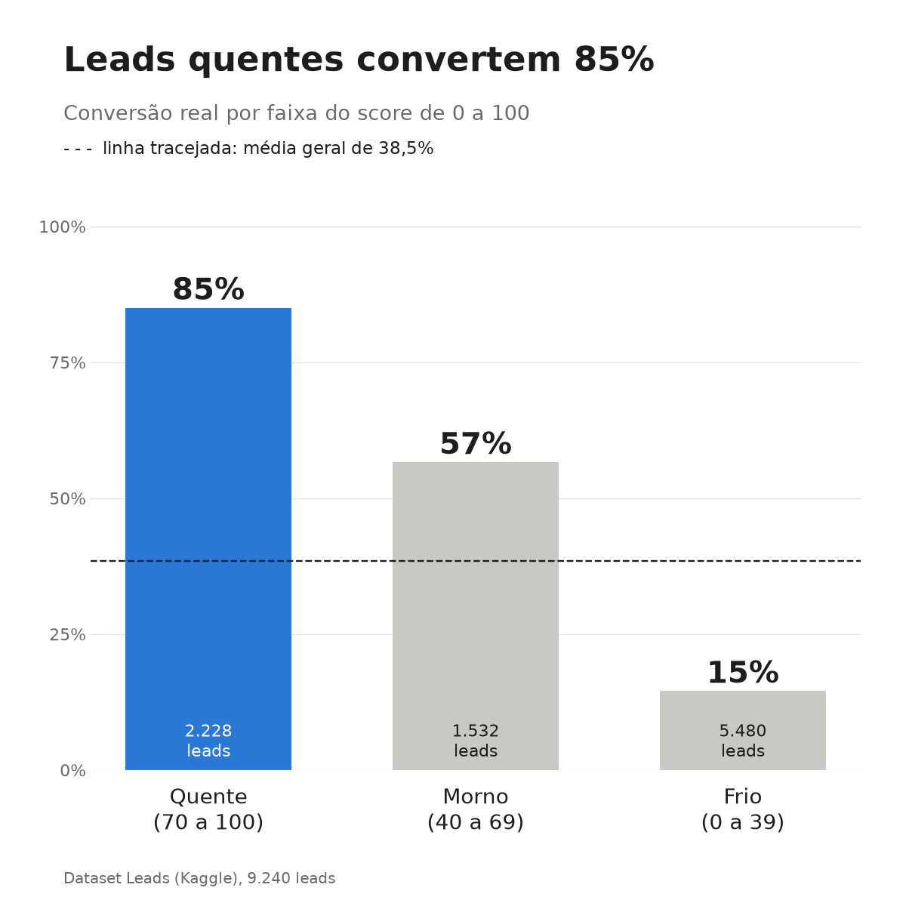
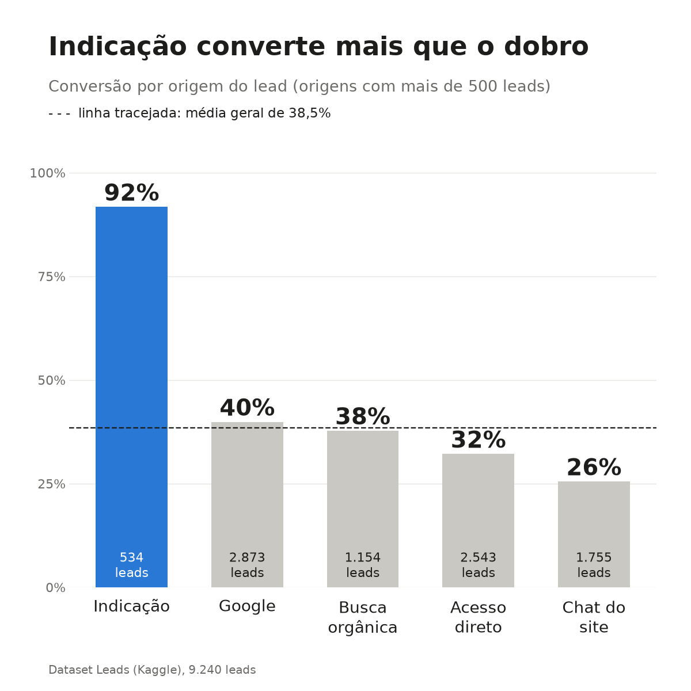
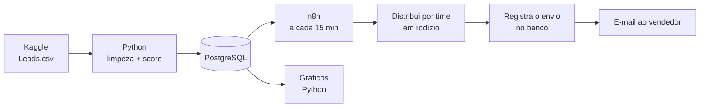
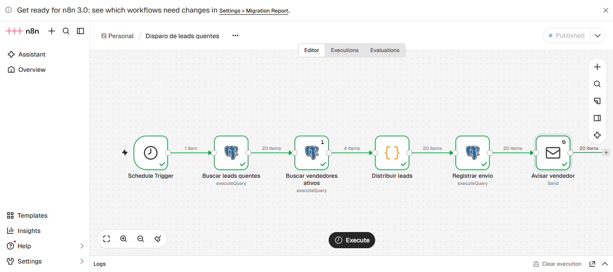
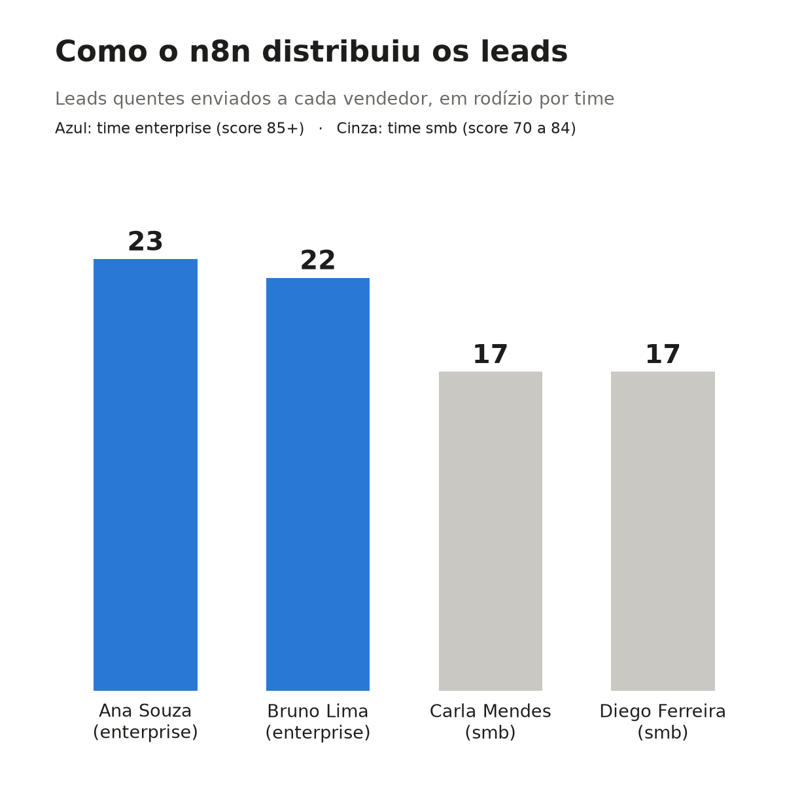
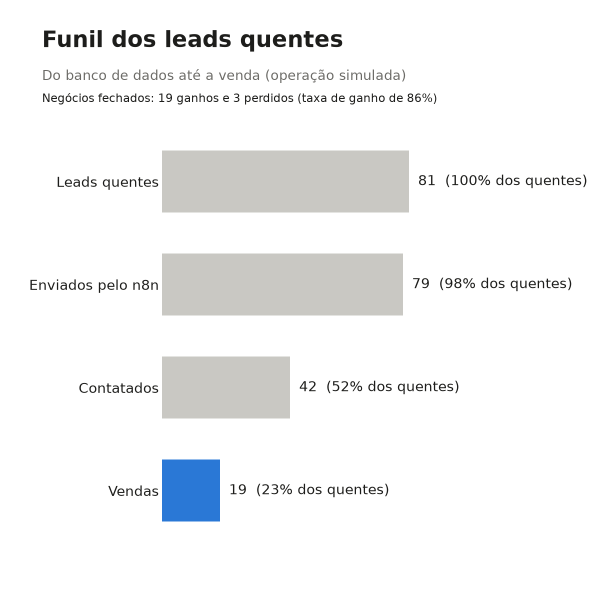

# Lead Engine: priorização e distribuição automática de leads

Projeto de estudo que combina **análise de dados, machine learning e automação** para resolver um problema comum de vendas: o time comercial gasta o mesmo esforço com todos os leads, sem saber quais têm mais chance de comprar.

Dados reais de **9.240 leads** de uma escola online (dataset público do Kaggle) → **score de 0 a 100** com Python → **distribuição automática** dos leads quentes com **n8n** → **gráficos** para acompanhar a operação.

---

## O problema

Uma escola online recebe milhares de interessados (leads), mas só **38,5%** compram um curso. O time comercial liga para todos, na ordem de chegada, e os leads com mais chance de compra esfriam na fila.

**Objetivo:** dar uma nota a cada lead e entregar automaticamente os mais promissores ao vendedor certo, em até 15 minutos.

## Principais resultados

| Resultado | Valor |
|---|---|
| Conversão geral da base | **38,5%** |
| Conversão dos leads de **indicação** | **92%** |
| Qualidade do modelo (AUC, validação cruzada) | **0,884** |
| Conversão real dos leads **quentes** (score 70+) | **85%** |
| Participação dos quentes na base / nas vendas | **24%** dos leads → **~53%** das vendas |

Em outras palavras: priorizando **um quarto dos leads**, o time comercial alcança **mais da metade das vendas**.





---

## Como funciona



### A automação no n8n



A cada 15 minutos, o workflow:

1. busca no banco até 20 leads **quentes** ainda não enviados (e que aceitam e-mail);
2. busca os vendedores ativos;
3. distribui os leads: **score 85+ vai para o time enterprise**, o restante para o **time smb**, em **rodízio** dentro de cada time;
4. marca o lead como enviado e registra o envio, **só se ele ainda estiver como "novo"**: um lead nunca é enviado duas vezes, mesmo que o workflow rode repetido;
5. envia um e-mail personalizado ao vendedor, com os dados do lead.





---

## Metodologia (DMAIC)

| Fase | O que foi feito |
|---|---|
| **Define** | Problema: esforço igual para leads com chances muito diferentes de compra |
| **Measure** | Linha de base: 38,5% de conversão geral (o enunciado do caso citava ~30%) |
| **Analyze** | Análise exploratória: indicação converte 92%, o chat do site só 25%. Limpeza dos dados (ex.: "Google" e "google" registrados como origens diferentes) |
| **Improve** | Modelo de score + automação da distribuição com n8n |
| **Control** | Gráficos de distribuição por vendedor e funil dos leads quentes |

## O modelo e a validação

- **Modelo:** regressão logística (scikit-learn), com 9 características do lead: origem, forma de entrada, última atividade, ocupação, especialização, cidade, visitas, tempo no site e páginas por visita.
- **Resposta prevista:** se o lead comprou (1) ou não (0).
- **Validação cruzada em 5 partes:** cada lead recebe a nota de um modelo que **não viu** a resposta dele.
- **AUC de 0,884:** comparando um lead que comprou com um que não comprou, o modelo dá a nota maior para quem comprou em 88% das vezes.
- **Calibração:** a nota média do modelo bate com a conversão real de cada origem.

| Origem | Nota média do modelo | Conversão real |
|---|---|---|
| Indicação | 91,2 | 91,8% |
| Google | 39,8 | 39,9% |
| Busca orgânica | 37,8 | 37,8% |
| Acesso direto | 32,4 | 32,2% |
| Chat do site | 25,7 | 25,5% |

Colunas preenchidas pelo time de vendas **depois** do contato (como *Tags* e *Lead Quality*) foram excluídas para evitar vazamento de dados.

---

## Ferramentas

| Camada | Ferramenta |
|---|---|
| Dados | Kaggle: [Leads Dataset](https://www.kaggle.com/datasets/ashydv/leads-dataset) |
| Análise e modelo | Python, pandas, scikit-learn |
| Banco de dados | PostgreSQL |
| Automação | n8n |
| E-mail de teste | Mailpit |
| Gráficos | matplotlib |
| Infraestrutura | Docker Compose, Git e GitHub |

## Estrutura do repositório

```
lead-engine/
├── docker-compose.yml        # PostgreSQL + n8n + Mailpit
├── sql/01_schema.sql         # tabelas do banco e vendedores de exemplo
├── scripts/
│   ├── explorar.py           # análise exploratória
│   ├── load_leads.py         # limpeza, score e carga no banco
│   ├── graficos.py           # gráficos de conversão
│   ├── simular_vendas.py     # simula o trabalho do time de vendas
│   └── graficos_operacao.py  # gráficos da operação (dados do banco)
├── n8n/                      # workflow exportado do n8n
└── docs/img/                 # gráficos e imagens
```

## Como rodar

1. Baixe o `Leads.csv` do Kaggle e salve em `data/`.
2. Crie um arquivo `.env` na raiz com: `POSTGRES_USER`, `POSTGRES_PASSWORD`, `POSTGRES_DB`, `POSTGRES_HOST=localhost` e `POSTGRES_PORT=5432`.
3. Suba os serviços: `docker compose up -d`.
4. Instale as bibliotecas: `pip install pandas scikit-learn faker psycopg2-binary matplotlib`.
5. Pontue e carregue os leads: `python scripts/load_leads.py`.
6. No n8n (`localhost:5678`), crie as credenciais do Postgres e do SMTP (host `mailpit`, porta `1025`) e importe o workflow da pasta `n8n/`.
7. Acompanhe os e-mails em `localhost:8025` e gere os gráficos com os scripts da pasta `scripts/`.

---

## Limitações e próximos passos

- **Operação simulada:** os dados dos leads são reais, mas os vendedores e o resultado das vendas são simulados. Nome, e-mail e telefone dos leads são fictícios (biblioteca Faker), pois o dataset é anonimizado.
- **Possível vazamento de dados:** a coluna "última atividade" pode registrar ações posteriores ao contato do vendedor. Próximo passo: treinar o modelo sem ela e comparar a AUC.
- **Comparação com uma regra simples:** medir quanto o modelo ganha em relação a priorizar apenas pela origem do lead.
- **Retreino periódico:** usar os resultados reais (ganhos e perdidos) para atualizar o modelo, fechando o ciclo de melhoria contínua.

---

Feito por **Caroline Molinari Langervisch** · [LinkedIn](www.linkedin.com/in/caroline-langervisch)